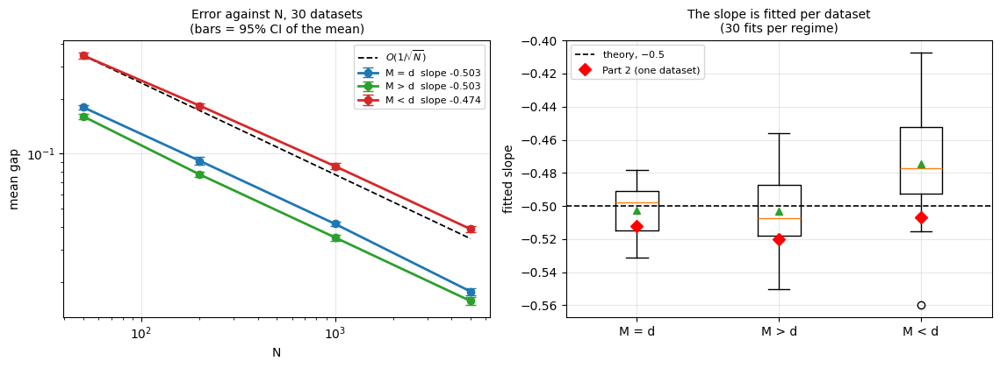
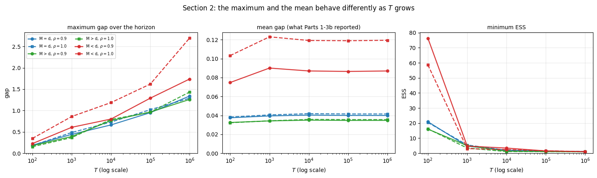
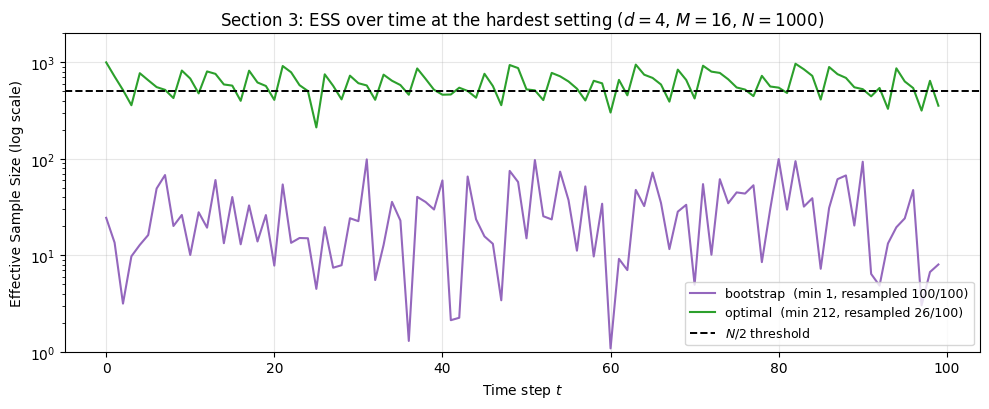
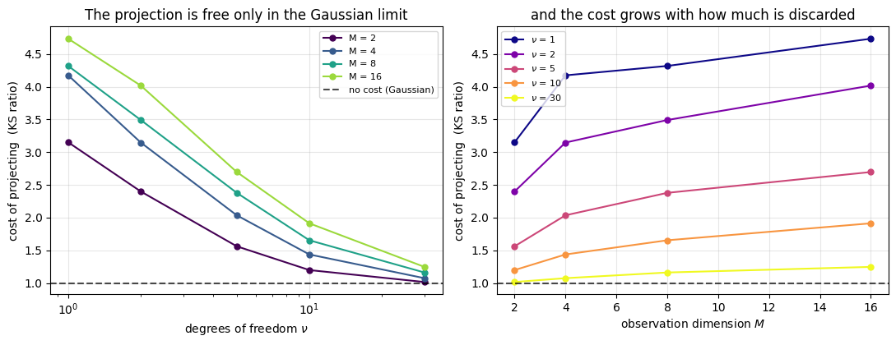
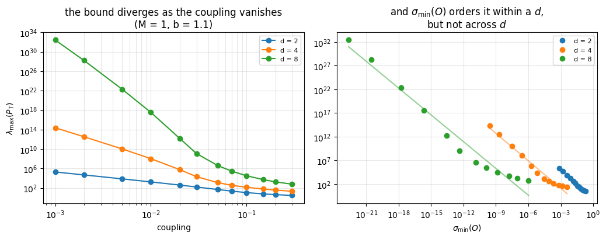
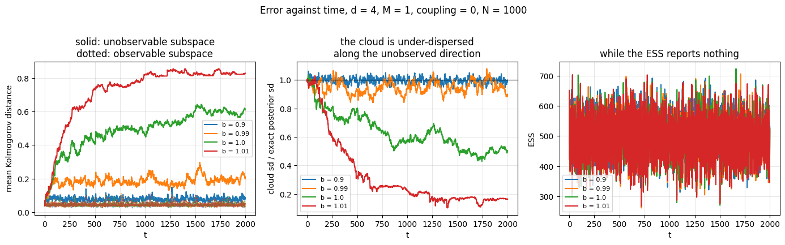
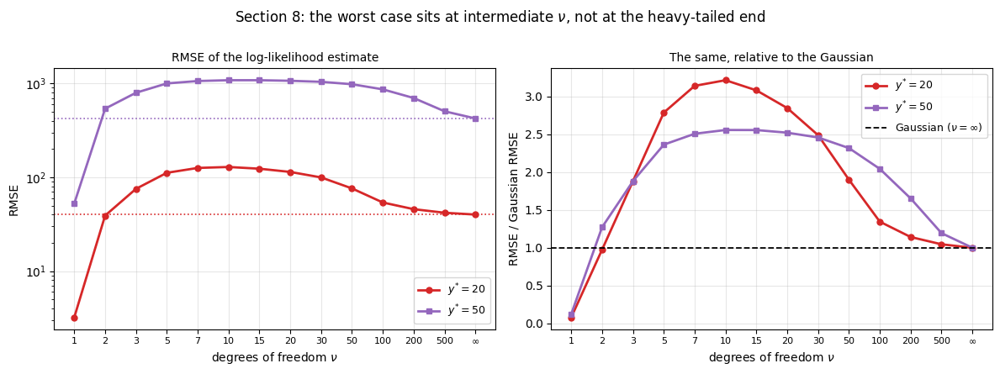
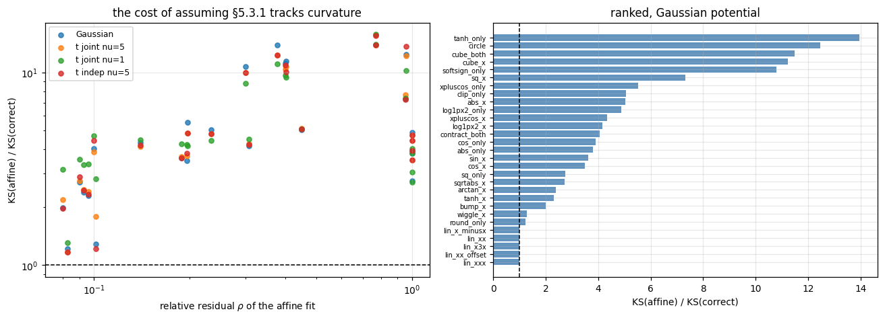
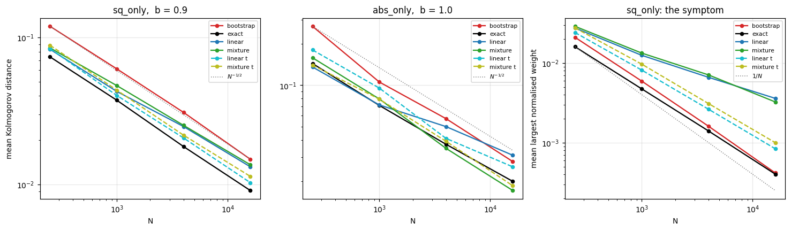

# Measuring particle filter error in state-space models

**Convergence, horizon, observability, and what happens past the linear-Gaussian case**

Supervised research project — Dr Mathieu Gerber, School of Mathematics, University of Bristol.
September–November 2026.

> This is the results report, organised by question. The [README](README.md) holds the
> chronological per-notebook write-up, including the reasoning that led to each study. Every section
> below names the notebooks it draws on.

---

## Contents

1. [What this work does](#1-what-this-work-does)
2. [What was built, and how it was checked](#2-what-was-built-and-how-it-was-checked)
3. [How things were measured](#3-how-things-were-measured)
4. [Convergence in `N`](#4-convergence-in-n)
5. [Behaviour in `T`](#5-behaviour-in-t)
6. [Dimension: `M` against `d`](#6-dimension-m-against-d)
7. [The stability threshold and observability](#7-the-stability-threshold-and-observability)
8. [Beyond linear-Gaussian](#8-beyond-linear-gaussian)
9. [Discussion](#9-discussion)
10. [Limitations](#10-limitations)
11. [Next](#11-next)
    - [Appendix A — notebook map](#appendix-a--notebook-map)
    - [Appendix B — claims withdrawn or corrected](#appendix-b--claims-withdrawn-or-corrected)

---

## 1. What this work does

In a linear-Gaussian state-space model the Kalman filter returns the exact posterior
`p(x_t | y_0:t)`. Any gap between it and a particle filter is therefore Monte Carlo error and
nothing else. That turns a bounding problem into a **measurement** problem, and makes this setting a
laboratory rather than a simulation study. Where the model stops being linear-Gaussian — a
Student-t likelihood, a nonlinear observation function — the Kalman filter is no longer exact, and
deterministic grid filters replace it as ground truth.

**What was swept**

| axis | range |
|---|---|
| particles `N` | 50 → 16,000 |
| horizon `T` | 10² → **10⁶** |
| state dimension `d` | 1 → 16 |
| observation dimension `M` | 1 → 16, spanning `M < d`, `M = d`, `M > d` |
| spectral radius `ρ(F)` | 0.5, 0.9, 0.99, 1.0, 1.01, 1.1 |
| state-noise tail `ν` | 1, 2, 3, 5, 7, 10, 15, 20, 30, 50, 100, 200, 500, ∞ |
| observation functions | 39 distinct `f`, × 4 likelihood potentials |
| proposals | 4, including an exact one as a ceiling |

**Theoretical context.** Del Moral & Gerber (2026, arXiv:2610.21587) bound the error of the particle
approximation uniformly over a trajectory, in the Kolmogorov norm, for a class of Feynman–Kac
models. This work measures the same quantity where it is computable, and tests two of the paper's
conditions directly: the requirement `r ≥ d` on the observation map, and the image condition of
§5.3.1. (Section 7.5.1 of that paper is an optimality argument giving a *lower* bound in a
degenerate model; the upper bound is Theorem 7.3.)

**Contributions**

- The `O(N^{-1/2})` rate is recovered to within a fraction of a standard error in the regimes the
  theory's conditions cover, and **degrades in the one regime they exclude**.
- The error's apparent growth with horizon is an **artefact of which statistic is reported**: over
  `10⁶` steps the mean is flat to three decimals while the maximum grows `7–9×`.
- **Detectability**, an exact rank test on `(F, H)`, rather than the number of observations, decides
  whether the posterior stays bounded — agreeing with the measured covariance recursion in 84 of 84
  cases.
- Across 39 nonlinear observation functions the filter is **close to indifferent to observation
  geometry** and sensitive only to likelihood sharpness relative to the proposal.

---

## 2. What was built, and how it was checked

Python, **NumPy only** — no SciPy, no filtering library. Every filter, benchmark and statistical
test written from scratch.

| module | lines | contents |
|---|---|---|
| [`filters.py`](filters.py) | 1,259 | Kalman and bootstrap particle filters, 1D and `d`-dimensional; model construction with exact spectral-radius control; ESS-triggered systematic resampling; Kolmogorov distance against a Gaussian posterior; observability matrix and subspaces; Hautus detectability test; data-free covariance recursion |
| [`observation_models.py`](observation_models.py) | 1,513 | 41-entry registry of observation functions with measured structural properties; four likelihood potentials; the §5.3.2 projection; affine surrogate; information-equalising control; exact grid benchmarks in `d = 1` and `d = 2`; four proposal distributions |
| [`student_t_filters.py`](student_t_filters.py) | 291 | Particle filter with Gaussian or Student-t state noise; grid filter giving the exact posterior of either model |

**Benchmarks.** Kalman where the model is linear-Gaussian; grid filters where it is not. The
distinction matters: scoring a Student-t particle filter against Kalman would conflate *approximation
error* — the particles failing to represent their target, which is the quantity of interest — with
*model error*, which would survive infinitely many particles. Each filter is scored against the exact
filter of its own model.

**Model construction.** `F` is built from a coupled tridiagonal base and rescaled,

```python
base = np.eye(d) + coupling * (np.eye(d, k=1) + np.eye(d, k=-1))
F = b * base / rho_base          # rho(F) = b exactly, any d, coupled or not
```

so `b` is the stability knob and `coupling` changes only the structure.

**Validation, before any result was taken**

| check | agreement |
|---|---|
| `d`-dimensional code vs 1D code at `d = M = 1` | machine precision, including which steps resampled |
| Kalman vs brute-force joint-Gaussian posterior (no recursion) | agrees |
| `grid_filter` vs Kalman | `1e-15` |
| `grid_filter_obs` vs Kalman | `1e-13` |
| `grid_filter_obs_2d` vs Kalman | `4e-15` |
| `normal_cdf` vs `math.erf` | max error `7.45e-8` |
| data-free covariance recursion vs Kalman | **exactly zero**, bit for bit, in ten cells |
| Kolmogorov metric on exact samples | `D ≈ 1.017/√N`, fitted slope `−0.5004` |

---

## 3. How things were measured

**Source:** Parts 3, 9, 11, 12.

### 3.1 Metrics, and why the choice matters

| metric | role |
|---|---|
| mean / maximum absolute gap | direct, but unbounded, and meaningless where the posterior is multimodal |
| relative gap — error ÷ posterior spread | compares regimes of different intrinsic difficulty |
| **Kolmogorov distance** `sup_z \|F_cloud(z) − F_exact(z)\|` | the quantity the theory bounds: at most 1 by construction, scale-free, defined under multimodality, and calibrated so a score `D` means about `(1.017/D)²` independent draws |

A result in its own right: **which statistic is reported decides whether the theory appears to
hold.** On identical runs over `T: 10² → 10⁶`, the mean grows `1.00–1.07×`, the 99.9th percentile
`1.46–2.31×`, and the maximum `2.95–4.00×`.

### 3.2 Cloud diagnostics

Effective sample size is reported as **both** mean and minimum, after finding that the two can give
overwhelmingly significant verdicts of opposite sign on the same runs: comparing a Cauchy filter
with a Gaussian one, minimum ESS says the Cauchy is healthier (`|t| = 6.39`) while mean ESS says it
is worse (`|t| = 80.07`).

### 3.3 Experimental design

- **Paired, per-dataset.** `data_seed = 100 + k`, `pf_seed = k`, for 12–30 independent datasets.
- Every quantity — slope, ratio, increment — is fitted **within** each dataset, and the fits are then
  summarised. Never one fit through dataset-averaged curves, which discards the pairing.
- 95% confidence intervals; one-sample `t` against theoretical values; Welch's `t` for unequal
  variances; paired `t` for trends.

### 3.4 Why single-dataset inference fails here

Several early results in this project were obtained from one simulated dataset with many *particle
filter* seeds averaged in. That design removes the filter's Monte Carlo noise and leaves the
dataset's contribution untouched — it sharpens the wrong number rather than fixing it. Re-testing
over 30 datasets overturned six claims; the full record is in [Appendix B](#appendix-b--claims-withdrawn-or-corrected).

The failures cluster predictably. Claims at risk are **extreme-value statistics that are free to
move** and **shape claims quoted without an effect size**. Time-averaged quantities failed **0 times
in 8** across four separate screens.

### 3.5 Pre-registration

In two studies the outcome of every claim was predicted from a stated rule **before any run**, and
the rule then scored: 7/10 and 3/7. In both cases the misses are reported as the result — a screen
that tests ten claims and reports which failed is only as informative as its prior, while one that
commits to a rule first is a test of the rule.

### 3.6 Confound control

Two separate studies required holding **total observation precision fixed** before the variable of
interest could be isolated — without it, an `M`-sweep measures sharpening and a comparison of
observation functions measures `‖J‖²` in disguise. Alongside: matched-cost baselines for every
proposal, dense versus canonical observation matrices, and identical-random-number checks confirming
that two filters are the same filter to `2e-15`.

---

## 4. Convergence in `N`

**Source:** [01](01_kf_pf_1d_comparison.ipynb), [02](02_md_dimension_study.ipynb),
[extensions/11](extensions/11_part2_error_bars.ipynb), [extensions/12](extensions/12_screen_2b_4_5.ipynb).

The `O(N^{-1/2})` Monte Carlo rate is recovered where the model is fully observed:

| regime | fitted slope | datasets |
|---|---|---|
| 1D, fully observed | `−0.493` | 1 |
| `M = d` | **`−0.5027 ± 0.0057`** | 30 |
| `M > d` | **`−0.5034 ± 0.0090`** | 30 |
| **`M < d`** | **`−0.4745 ± 0.0108`** | 30 |

`M < d` sits **4.6 standard errors** from the theoretical `−0.5` and 4.5 from `M = d`. The same
measurement at `ρ(F) = 1` gives `−0.4693 ± 0.0151` — two independent measurements agreeing, which
establishes that the deficit belongs to the direction being **unconstrained by the data**, not to
what the dynamics do to it.

A consequence: the under-observation penalty cannot be a constant factor, and is not. It rises
`1.93 → 2.23` over `N = 50` to `5000`, paired `t = +4.4`.

**Interpretation.** The paper's state-space class takes `H_t : R^d → R^r` with `r ≥ d`, and the
relaxed condition of §5.3.1 requires `H_t(R^d)` to be a `d`-dimensional linear subspace — neither of
which can hold when `M < d`, by dimension counting. **The rate holds, to within a fraction of a
standard error, in exactly the regimes the conditions cover, and degrades in the one they exclude.**



***Figure 1.*** *Left: mean gap against `N` over 30 datasets, 95% CIs, against the `O(N^{-1/2})`
reference. Right: the slope fitted **within** each dataset, 30 fits per regime; the red diamond is
the single-dataset value originally reported. `M < d` sits clearly above `−0.5` and the
single-dataset estimate sat below its own distribution.
Source: [extensions/11](extensions/11_part2_error_bars.ipynb).*

---

## 5. Behaviour in `T`

**Source:** [06](06_long_horizons.ipynb), [extensions/09](extensions/09_kolmogorov_distance.ipynb).

Runs extend to `T = 10⁶`. The finding concerns the measurement rather than the horizon.

| statistic | growth over `T: 10² → 10⁶` |
|---|---|
| **maximum** gap | **7.1× – 9.4×** |
| **mean** gap | 1.06× – 1.16× |

From `T = 10⁴` onwards the mean is flat to three decimal places (`0.0404`, `0.0400`, `0.0399` at
`10⁴`, `10⁵`, `10⁶`). Earlier parts of this project compared halves of a single run on the mean — a
design whose expected signal is `1.05` at `T = 2000` and *smaller* at `10⁶`, against measured noise
of about ±3%. **Those studies were not limited by running too short; they were measuring a quantity
that does not move.**



***Figure 2.*** *The same runs, three statistics. The maximum gap climbs steadily to `T = 10⁶`; the
mean is flat from `10³` onward; the minimum ESS collapses early and then stops changing. Which of
these is reported decides what the horizon appears to do.
Source: [06](06_long_horizons.ipynb).*

Growth is **logarithmic, not polynomial**: `(log T)^a` fits better than `T^b` in all six
configurations (`R² ≈ 0.98–0.99` against `0.92–0.96`), with `a = 1.74–2.03`.

The threshold shows only where observations fall short — at `T = 10⁶`, the maximum gap is **55%**
worse at `ρ = 1` than at `ρ = 0.9` for `M < d`, where `M = d` and `M > d` move by a few per cent.

**On the bounded metric.** Re-measured as a Kolmogorov distance, the per-step error distribution is
**stationary over a million steps**, so the growing maximum is an extreme-value effect rather than
degradation — longer runs do not make the filter worse, they give more chances to observe the same
rare bad step. The 99.9th percentile grows like `(log T)^{0.35–0.71}`, bracketing the `0.5` that
appears in the theory, and the `√N` collapse is recovered (`N^{-0.479}` to `N^{-0.482}`, against
`N^{-0.22}` to `N^{-0.36}` on the unbounded metric).

---

## 6. Dimension: `M` against `d`

**Source:** [02](02_md_dimension_study.ipynb), [02b](02b_md_dimension_rho1.ipynb),
[03](03_robustness_study.ipynb), [07](07_student_t_likelihood.ipynb).

### Degeneracy is driven by likelihood sharpness, not state dimension

Growing `d` from 1 to 16 at `M = 1` left the cloud healthy throughout — minimum ESS never below ~90,
mean pinned near 530 — while the relative gap crept from `0.033` to `0.064` and flattened. Growing
`M` from 1 to 16 at `d = 4` drove the minimum ESS from `94` to **`1.3`**, forced resampling at every
single step, and quadrupled the relative gap to `0.22`.

### And the degeneracy belongs to the proposal, not to particle filtering

The bootstrap filter moves particles using the state equation alone, consulting the observation only
afterwards. The locally optimal proposal samples from `p(x_t | x_{t-1}, y_t)` instead.

| `M` (at `d = 4`) | bootstrap min ESS | optimal min ESS | bootstrap rel. gap | optimal rel. gap |
|---|---|---|---|---|
| 1 | 63.1 | 257.1 | 0.0628 | 0.0401 |
| 4 | 7.2 | 162.8 | 0.0963 | 0.0427 |
| 16 | **1.4** | **223.9** | **0.2145** | **0.0387** |

A **160×** difference in effective particles at `M = 16`, and the accuracy trend separates too: the
bootstrap relative gap degrades `3.4×` as `M` grows while the optimal proposal's stays flat at ~0.04.



***Figure 3.*** *Effective sample size at the hardest setting (`d = 4`, `M = 16`, `N = 1000`), log
scale. The bootstrap filter spends the run below 100 effective particles and resamples at all 100
steps; the optimal proposal stays around the `N/2` threshold and resamples 26 times.
Source: [03](03_robustness_study.ipynb).*
The honest statement is not "large `M` breaks particle filters" but **"large `M` breaks filters that
propose blindly from the prior"** — a fixable problem, not a fundamental barrier.

### At fixed total precision, extra coordinates cost nothing

Part 2's convention raised precision as `M` grew. Setting `Σ = M r₀ I` instead holds it fixed, and
the exact posterior spread is then identical at every `M` — `0.78593` at `M = 1, 2, 4, 8, 16`, to
five decimals.

| potential | mean Kolmogorov distance, `M: 1 → 16` |
|---|---|
| Gaussian | `0.0459 → 0.0447` |
| Student-t `ν = 5` | `0.0444 → 0.0433` |
| Student-t `ν = 1` | `0.0436 → 0.0433` |

Flat everywhere. Under the original convention the cloud's worth roughly halves — but by the same
factor for every likelihood (`1.50`, `1.46`, `1.53`, `1.54` for Gaussian and `ν = 1, 5, 30`). **A
mechanism that behaves identically from Cauchy to near-Gaussian is not a tail mechanism**; it is
sharpening.

### The projection stops being free once the likelihood is heavy-tailed

Cost of replacing `y` by its `d`-dimensional projection, as a ratio of mean Kolmogorov distances:

| `ν` | `M=2` | `M=4` | `M=8` | `M=16` |
|---|---|---|---|---|
| 1 | 3.15 | 4.17 | 4.32 | **4.73** |
| 2 | 2.40 | 3.15 | 3.49 | 4.02 |
| 5 | 1.56 | 2.04 | 2.38 | 2.70 |
| 10 | 1.20 | 1.44 | 1.65 | 1.91 |
| 30 | 1.02 | 1.08 | 1.16 | 1.25 |

Monotone in both directions across all twenty cells, and converging to exactly the right place: at
`M = 8` the cost is `2.379`, `1.162`, `1.020`, `1.008`, `1.000` for `ν = 5, 30, 100, 1000` and
Gaussian. Under a Gaussian likelihood the full and projected filters agree to `2e-15` on identical
random numbers — they are the same filter.



***Figure 4.*** *Left: the cost of discarding the orthogonal component falls monotonically to 1 as
`ν → ∞`, reaching the Gaussian limit by `ν = 30` with nothing fitted. Right: the same cost grows
with how much is discarded. Under a Gaussian likelihood the projection is exactly free.
Source: [07](07_student_t_likelihood.ipynb).*

**Mechanism.** The discarded component `w_t` carries no information about `x_t` — that is geometry —
but it carries information about *how far to trust* the component that does. Split by residual size
at `M = 8, ν = 2`:

| steps | full | projected | excess |
|---|---|---|---|
| quiet (`‖w‖²` below median) | 0.0486 | 0.1397 | 0.0911 |
| wild (top 10%) | 0.0349 | 0.2250 | **0.1901** |

On the wild steps the full filter beats its own average while the projected filter collapses. A
large `‖w‖²` means the coordinates disagree, which under a shared-scale Student-t is the signature of
an outlier: the full filter sees it and discounts the observation, the projected filter has thrown
the evidence away.

---

## 7. The stability threshold and observability

**Source:** [05](05_f_stability_threshold.ipynb), [extensions/10](extensions/10_detectability_boundary.ipynb).

### Crossing `ρ(F) = 1` costs a fully observed filter almost nothing

From `b = 0.9` to `b = 1.1` the state grows by a factor of `1.3e7` while the exact posterior spread
moves from `0.773` to `0.799` — a factor of `1.034`. Over 30 datasets the relative gap rises about
4.5%, marginally detectable (`|t| = 2.1`), then saturates.

The reason: the variance recursion has a bounded fixed point even when the state recursion does not.
**An unstable model is not a difficult inference problem.** Stability is also a property of `F`'s
eigenvalues, not its entries — at `d = 4`, `coupling = 0.3`, `ρ(F) = 1.1`, every entry of `F` is
`0.7405` or smaller and the state still reaches `1.6e8`.

### What breaks is detectability

With an explosive direction unobserved (`d = 2`, `M = 1`), the exact posterior variance in that
direction reaches `1.25e13` at `b = 1.1` against `0.64` when it is observed — while the ESS stays
healthy at 50–65. **The divergence is in the posterior itself, not in its particle approximation, so
no filter can repair it.**

### There is no boundary in `M`

Sweeping `M` from 1 to `d` over 84 cells (`d = 2, 4, 8`; `b = 1.0, 1.01, 1.1`; coupling `0` and
`0.2`) — settled without simulating any data, since the covariance recursion never reads `y`:

- At **coupling 0**, every `M < d` diverges and every `M = d` is bounded, with nothing between. The
  diverging cells all report `λ_max = 6.1934e33` *identically*, at every `d` and every `M` from 1 to
  `d−1`. **Seven observations of an eight-dimensional state are worth exactly as much as one.**
- At **coupling 0.2** the cliff is gone — every cell bounded, including `M = 1` at `d = 8`, where
  one scalar per step holds the posterior variance of an explosive 8-dimensional state at `1815`.



***Figure 5.*** *Left: the posterior bound diverges as the coupling vanishes — continuous in the
coupling, discontinuous in boundedness, with the jump to `6.2e33` only at exactly zero. Right:
`σ_min(O)` orders the bound cleanly within a fixed `d` and fails across `d`, which is why it is
reported as a negative result rather than as a continuous detectability margin.
Source: [extensions/10](extensions/10_detectability_boundary.ipynb).*

### Detectability decides it, exactly

Every eigenvalue of `F` with `|λ| ≥ 1` must be observable (the Hautus test,
`rank [F − λI; H] = d`). It agreed with the measured recursion in **84 of 84 cells**, computed in
microseconds where the recursion needs 1,600 steps. The rate confirms the mechanism: every diverging
cell grows at **exactly** `2 log b`, and at `ρ = 1` exactly the divergence is **linear** —
`λ_max(P_t) = 1.0000 t`, the constant being `Q` — which a geometric test cannot see.

The cliff belongs to `F`, not `H`: at coupling 0, `F = bI`, so `HF^k = b^k H` and every block of the
observability matrix is a multiple of the first. A dense random `H` mixing every coordinate into
every measurement gives the same `6.1934e33` to five figures as a sparse canonical selector.

**Where the test stops being useful.** At `d = 8` and coupling `≤ 0.01`, `σ_min(O)` reaches `2.2e-16`
and the *numerical* rank drops to 7, then 6, then 5, while the mathematical rank is 8 throughout.
These models are **detectable and unfilterable**: a theorem resting on a rank gives no warning that
the information it relies on is carried at `1e-23`.

### The only unbounded error in the project

Scored separately along the observable and unobservable subspaces, at `N = 1000`:

| `b` | `t = 0` | `t = 199` | `t = 1999` |
|---|---|---|---|
| 0.9 | 0.0379 | 0.0669 | 0.0814 |
| 1.0 | 0.0379 | 0.3389 | **0.6099** |
| 1.01 | 0.0379 | 0.4816 | **0.8290** |

The **observable** subspace of the very same runs stays at `0.040–0.045` at every `t` and every `b`,
and `b = 0.9` is flat to 0.3% over `T = 2000`. At `b = 1.0` exactly, `b^T = 1` and the state is a
random walk of size `√T ≈ 45`, so no floating-point explanation is available.

The mechanism was measured, not inferred: the cloud becomes progressively **under-dispersed** along
the unobserved direction — its spread as a fraction of the exact posterior's falls
`1.00 → 0.81 → 0.57 → 0.50` at `b = 1.0` and to `0.16` at `b = 1.01`. The cause is resampling:
weights come from the observed coordinates alone, so every resampling event prunes diversity in a
direction that carries no information to justify the pruning.

**And the standard diagnostic reports nothing.** The ESS sits at 500–650 of 1000 in all four runs,
with no trend and no difference between `b = 0.9` and `b = 1.01` — a healthy-looking filter at every
step of a run whose error had grown twentyfold.



***Figure 6.*** *`d = 4`, `M = 1`, coupling `0`, `N = 1000`, over `T = 2000`. Left: error in the
unobservable subspace (solid) grows without bound at and above the threshold while the observable
subspace of the same runs (dotted) stays flat. Centre: the cloud becomes progressively
under-dispersed along the unobserved direction. Right: the ESS reports nothing — no trend, and no
difference between `b = 0.9` and `b = 1.01`.
Source: [extensions/10](extensions/10_detectability_boundary.ipynb).*

---

## 8. Beyond linear-Gaussian

**Source:** [04](04_student_t_vs_gaussian.ipynb), [04b](04b_student_t_rho1.ipynb),
[08](08_nonlinear_observations.ipynb), [extensions/13](extensions/13_proposals_nonlinear.ipynb).

### Heavy-tailed state noise: the effect is non-monotonic in `ν`

The conjecture under test was that a particle filter run with Student-t state noise should be less
stable than a Gaussian one when observations are unbounded.

- **On in-model data there is no difference at all** — every filter from Gaussian to Cauchy sits at
  about `0.028`. In-model observations never get large: the largest `|y_t|` is about `11.7` over
  100,000 steps, the maximum of `T` Gaussian draws growing like `√(2 log T)`. The regime the
  conjecture concerns is never visited.
- **Under one large observation it holds for moderate tails**, and robustly — the Student-t filters
  are worse than the Gaussian in **12 of 12** independent datasets at `ν = 5` (median `11×`) and
  `ν = 3` (median `21×`). At `ν = 5` more particles do not help: the likelihood variance reads
  `415, 528, 527, 503` as `N` goes from 250 to 16,000.
- **But the Cauchy is the most stable of all** — better than the Gaussian in 12 of 12, median
  `0.08×`.
- **The worst case is interior.** Sweeping `ν` from 1 to 500 at `y* = 20` and `y* = 50` gives a
  maximum at **`ν ≈ 10`**, about `3.2×` the Gaussian's log-likelihood RMSE, after which the curve
  falls monotonically back to the Gaussian.

The mechanism is a competition: heavier tails move the filter's own target further out, making it
harder to represent, but also let particles reach further, making it easier to sample. At `y* = 20`
the typical furthest of 1000 particles reaches `3.4` (Gaussian), `7.4` (`ν = 5`), `15.9` (`ν = 3`)
and about `1000` (`ν = 1`). So the honest statement is not "heavier tails are less stable" but
**"tails heavy enough to move the target, but not heavy enough to let particles follow"**.



***Figure 7.*** *Log-likelihood RMSE under a single large observation, swept over `ν`. The worst case
is interior — about `3.2×` the Gaussian at `ν ≈ 10` — and the Cauchy (`ν = 1`) is better than the
Gaussian at both observation sizes. 150 seeds per point.
Source: [04](04_student_t_vs_gaussian.ipynb) §8.*

### Nonlinear observation functions: the shape of `f` costs nothing

`y_t = f(x_t) + ε_t`, with **39 distinct `f`** crossed with four potentials and three filter
variants, in `d = 1` and `d = 2`, benchmarked against grid filters.

The registry is a factorial over the theory's conditions rather than a sweep, because **§5.3.1 is a
condition on the image, not on linearity, and the two come apart**:

| `f` | bi-Lipschitz? | image | reduction |
|---|---|---|---|
| `[x³, x³]` | no — constants span `9.8e-10` to `1.5e2` | a **line** | **holds** |
| `[x + cos x, x]` | yes — constants `1.00` and `2.24` | a **curve** | **fails** |

Structure is measured rather than asserted, which mattered: the registry's hand-set flags were wrong
in **7 of 41 entries**. The census also found two pairs to be the same map under two names, so 41
entries are 39 functions.

Holding precision fixed is again essential — at `Σ = I` the cubic is `18x⁴` times as informative as
the identity, so comparing shapes at a common `Σ` would be a study of `‖J‖²` in disguise.

**The main result is negative.** Over 122 cells the mean Kolmogorov distance is `0.0474`, spread
`0.0390` to `0.0950` — a factor of `2.4` between the best and worst cell in the entire matrix:

| group | n | Gaussian | t joint `ν=5` | t joint `ν=1` | t indep `ν=5` |
|---|---|---|---|---|---|
| A: linear image | 7 | `0.0489 ± 0.0053` | `0.0482 ± 0.0058` | `0.0461 ± 0.0055` | `0.0476 ± 0.0074` |
| B1: curved, bi-Lipschitz | 10 | `0.0464 ± 0.0032` | `0.0466 ± 0.0017` | `0.0445 ± 0.0014` | `0.0456 ± 0.0018` |
| B2: curved, upper bound only | 4 | `0.0541 ± 0.0067` | `0.0538 ± 0.0064` | `0.0500 ± 0.0058` | `0.0536 ± 0.0054` |
| C: (P1)b violated | 10 | `0.0514 ± 0.0161` | `0.0461 ± 0.0058` | `0.0444 ± 0.0070` | `0.0461 ± 0.0058` |

The groups are as structurally different as the paper's conditions allow and **agree to within their
own scatter**. `clip(x, ±3)`, which destroys information outright, is the *best* cell in the matrix;
`round(x)`, discontinuous with zero derivative almost everywhere, scores `0.0418`. Scaling in `N`
confirms this is sampling error rather than bias — slopes `−0.478` to `−0.509`.



***Figure 8.*** *Left: the cost of forcing the affine reduction tracks the curvature of `f`, and is
close to unchanged across the four potentials — the cost is geometric, not distributional. Right:
the same cost ranked by function, from the linear images at exactly 1 to `tanh` at `14×`.
Source: [08](08_nonlinear_observations.ipynb).*

**What does cost something**

| | cost |
|---|---|
| assuming §5.3.1 where it fails | `1.2×` – **`15.9×`** (worst `eˣ`), and geometric rather than distributional: reading across four potentials changes it by at most ~20% |
| the projection under a heavy tail | `1.30×` – `3.22×`, exactly `1.000` under a Gaussian, decaying to 1 by `ν = 30` |
| non-injectivity, once the state wanders | harmless at `b = 0.9`, up to **`6.5×`** at `b = 1` — for an even `f` the modes sit `2\|x_t\|` apart, growing with the state, while the proposal moves `O(1)` per step |
| under-observation *along a curve* | `‖x‖` (`0.270`) and `x₁x₂` (`0.235`) cost twice what `x₁` (`0.121`) or `x₁+x₂` (`0.118`) cost |

**Synthesis.** Taken with the dimension results: the bootstrap filter is sensitive to how sharp the
likelihood is relative to the proposal, and close to indifferent to the geometry of the map
producing it.

### Proposals, once there is no closed form

The locally optimal proposal has a closed form only because the model is linear-Gaussian. Four
proposals were compared on a general scalar `f` — bootstrap, an **exact** one by numerical CDF
inversion serving as a ceiling, an EKF-style linearisation, and a mixture over likelihood modes.

- **The rescue survives but is modest** — ceiling `1.25×`–`1.71×`, with one linearisation recovering
  `68% ± 7%` of it. On a bimodal posterior a single linearisation scores `0.837 ± 0.060`, **16%
  worse than doing nothing**, because it commits to whichever branch the prior mean sits nearer; the
  mixture recovers `1.247 ± 0.058` against the ceiling's `1.249`.
- **The approximations give up the `N^{-1/2}` rate** — `−0.4414 ± 0.0165` and `−0.4419 ± 0.0114`
  against the exact proposal's `−0.5049 ± 0.0137`. This was predicted before measurement: a proposal
  that uses the observation is narrower than the prior, so the importance weight it needs is
  unbounded, and the CLT's finite-variance condition fails. Confirmed independently by the heaviest
  normalised weight falling at `N^{-0.49}` instead of the bootstrap's `N^{-0.95}`; at `N = 16,000`
  one particle still carries `58×` its fair share.
- **Student-t proposal components (`ν = 5`) restore the rate for free** — `−0.5015 ± 0.0102`, and
  22% *more* accurate at `N = 16,000`. Nothing was fitted.
- **Cost inverts the ranking.** The exact proposal costs `31×` for a `1.71×` gain where the same
  budget spent on particles buys `5.58×`. Only the cheap linearisation beats a matched-cost
  baseline — and only its heavy-tailed version also keeps the rate.
- **What no proposal fixes:** the error still rises with `|x|` by the same factor for all four.
  Proposals shift the curve down; none flattens it. A locally optimal proposal is local *in time*,
  and resolving the sign of a symmetric `f` requires path information.



***Figure 9.*** *Left and centre: accuracy against `N` for six proposals on two cells, with the
`N^{-1/2}` reference. Right: the symptom — the mean largest normalised weight against `N`, with
`1/N` for reference. The Gaussian approximations sit visibly shallower than `N^{-1/2}`; their
Student-t versions recover it.
Source: [extensions/13](extensions/13_proposals_nonlinear.ipynb).*

---

## 9. Discussion

**One pattern runs through every result.** What hurts the bootstrap filter is the *sharpness of the
likelihood relative to the proposal* — reached variously by adding observation coordinates, by
raising precision directly, by a nonlinear `f` that concentrates information, or by two modes that
must both be satisfied. The geometry of the observation map is close to irrelevant once precision is
controlled for, and in every case the repair is to the proposal rather than to the filter.

**A second pattern is methodological.** The choice of summary statistic changed the conclusion in
three separate places: horizon growth (mean flat, maximum `7–9×`), cloud health (minimum and mean
ESS disagreeing at overwhelming significance), and accuracy under a non-injective `f` (a mean-based
metric reporting catastrophic failure where the filter is performing normally).

**What bears on the theory, and what does not.** The paper's bound is on the maximum over `t` of the
Kolmogorov norm, holding with high probability. Measurements of a time-averaged error therefore
cannot be used to call its conditions conservative. Two further gaps are worth stating: the
Kolmogorov distance here is computed marginally along directions, where the paper's `‖·‖_K` is the
`d`-dimensional orthant version — the two coincide in `d = 1` and are different functionals beyond
it; and the `M < d` regime, where every anomaly in this project lives, falls outside the paper's
model class entirely.

---

## 10. Limitations

- `d = 1` wherever an exact grid benchmark is required, which covers all of §8 except the `d = 2`
  registry entries.
- `ρ(F) > 1` at long horizons is limited by floating-point cancellation: at `b = 1.1`, `T = 2000`,
  the error freezes at `0.7288` from `t = 499` onwards, which would be easy to present as
  saturation and is not.
- `N` swept over two decades (`50`–`16,000`), which cannot separate an asymptotic rate from a slow
  transient.
- The Kolmogorov distance is computed marginally, not as the `d`-dimensional orthant version.
- Two observation functions (`eˣ`, `x/(1+|x|)`) are unusable at `ρ(F) = 1`, their Fisher information
  varying by `1e41` and `3e3` along a single trajectory.
- Single machine, NumPy only, double precision throughout.

---

## 11. Next

Four items, each with a prediction attached so the next report can score it.

1. **The shape-fixed Student-t control** — a Gaussian filter run at the Student-t's reduced scale.
   *Prediction: it accounts for most of the `ν ≈ 10` effect.*
2. **The orthant Kolmogorov distance in `d > 1`**, replacing the marginal version.
   *Prediction: the ordering of regimes survives; the magnitudes do not.*
3. **`N` to `10⁶` at `T = 100`** to settle whether the `M < d` rate deficit is asymptotic.
   *Prediction: the slope stays below `−0.49` and does not return to `−0.5`.*
4. **Sweep `M` from 1 to `d` for the per-coordinate rate**, connecting §4 to §7.
   *Prediction: the deficit is monotone in the number of unobserved directions.*

---

## Appendix A — notebook map

Parts in the repository root were assigned; `extensions/` holds work that followed from them.

| § | Notebooks | Assigned? |
|---|---|---|
| 2 | [`filters.py`](filters.py), [`observation_models.py`](observation_models.py), [`student_t_filters.py`](student_t_filters.py) | — |
| 3 | [03](03_robustness_study.ipynb), [extensions/09](extensions/09_kolmogorov_distance.ipynb), [extensions/11](extensions/11_part2_error_bars.ipynb), [extensions/12](extensions/12_screen_2b_4_5.ipynb) | mixed |
| 4 | [01](01_kf_pf_1d_comparison.ipynb), [02](02_md_dimension_study.ipynb), [extensions/11](extensions/11_part2_error_bars.ipynb), [extensions/12](extensions/12_screen_2b_4_5.ipynb) | mixed |
| 5 | [06](06_long_horizons.ipynb), [extensions/09](extensions/09_kolmogorov_distance.ipynb) | mixed |
| 6 | [02](02_md_dimension_study.ipynb), [02b](02b_md_dimension_rho1.ipynb), [03](03_robustness_study.ipynb), [07](07_student_t_likelihood.ipynb) | yes |
| 7 | [05](05_f_stability_threshold.ipynb), [extensions/10](extensions/10_detectability_boundary.ipynb) | mixed |
| 8 | [04](04_student_t_vs_gaussian.ipynb), [04b](04b_student_t_rho1.ipynb), [08](08_nonlinear_observations.ipynb), [extensions/13](extensions/13_proposals_nonlinear.ipynb) | mixed |

---

## Appendix B — claims withdrawn or corrected

Eleven claims made earlier in this project were overturned by its own later work, together with one
prediction of what that work would find.

| earlier claim | what replaced it | found by |
|---|---|---|
| The `1/√N` rate holds in every regime | Holds for `M ≥ d`; `M < d` gives `−0.4745 ± 0.0108` | Part 11 |
| Under-observation costs a constant ~2× | The penalty grows with `N`: `1.93 → 2.23`, paired `t = +4.4` | Part 11 |
| The `M < d` cloud is healthier (min ESS 83) | Indistinguishable (`\|t\| = 0.98`); `82.7` lies outside the entire range of 30 fresh datasets (`8.0`–`54.4`) | Part 11 |
| The error concentrates `2.6×` in unmeasured coordinates | `2.86 ± 0.11`, but the posterior is `1.834×` wider there; the filter's own share is `1.562 ± 0.061` | Part 11 |
| The rate also survives at `ρ = 1` | `−0.4693 ± 0.0151` | Part 12 |
| The Student-t and Gaussian filters perform similarly | Three of six separate; the Cauchy by `1.101×`, `\|t\| = 10.56` | Part 12 |
| The Student-t filters have a healthier cloud | The sign flips with the diagnostic: `\|t\| = 6.39` on minimum ESS, `80.07` the other way on mean ESS | Part 12 |
| More information can make the particle filter worse | Withdrawn — it is precision, not information | Parts 5, 7 |
| Degeneracy is driven by `M`, not by `d` | Withdrawn — same reason | Part 5 |
| The three regimes perform near-identically | Corrected — the ordering survives, "almost identical" does not | Part 3 |
| For `x²`, more particles stop helping (`−0.342`) | `−0.5007 ± 0.0207` over 12 datasets; 0 of 12 above `−0.40` | Part 13 |
| *(prediction)* the rate deficit is worse at `ρ = 1` | Identical: `−0.4693` against `−0.4745` | Part 12 |

Every one traces to the same cause: a claim made from a single simulated dataset with additional
*filter* seeds averaged in.

---

## References

Del Moral, P. & Gerber, M. (2026). *A perturbation theory for Feynman–Kac models and their particle
interpretations.* arXiv:2610.21587.

Doucet, A., Godsill, S. & Andrieu, C. (2000). *On sequential Monte Carlo sampling methods for
Bayesian filtering.* Statistics and Computing, 10(3), 197–208.

Gerber, M. & Chopin, N. (2015). *Sequential Quasi-Monte Carlo.* Journal of the Royal Statistical
Society: Series B, 77(3), 509–579.
